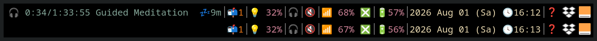

# newsboat-podcasts

*Podcasts in [newsboat](https://newsboat.org), the way you already read your
feeds: select an episode, press one key, it plays. No second program, no queue,
no download step you did not ask for.*



*Top: an episode is playing — position, length, title, and 💤9m until the sleep
timer pauses it. Bottom: the same bar with nothing playing. The block is gone.*

> **🇩🇪 Deutsche Fassung:** [ganz unten](#deutsch). 👇

---

## Honest foreword

I am **not a programmer**. I read my news in newsboat and wanted my podcasts
there too — and found the built-in way clumsy. The code was written for me by
**[Claude Code](https://claude.com/claude-code)**; I said what I wanted and
tested whether it worked. I am publishing it because the same annoyance
probably bothers other people, and because three of the pitfalls we hit cost us
a whole afternoon and are documented nowhere. 🙂

---

## The problem

newsboat has podcast support, but it is a two-step affair: you mark an episode
for download, quit to a second program called `podboat`, download it there, and
play it there. For "I want to hear this now", that is three steps too many.
The frustration is not new — LARBS ships a helper script that opens with the
comment `# Podboat sucks. This script replaces it.`

## What this does

| Key | Action |
|-----|--------|
| `,m` | play the selected episode immediately |
| `,l` | download it in the background to `~/Podcasts/<podcast>/` |

Plus, around that:

- **Only one playback at a time.** Starting another episode replaces the
  running one instead of adding to the noise.
- **Sleep timer.** Pauses after 30 minutes (configurable) rather than stopping,
  so the position is kept.
- **Headset button / media keys** pause and resume, via MPRIS.
- **Seek** in 30-second steps from a key binding.
- **A status bar block** (i3blocks) showing position, length and the remaining
  sleep time — and nothing at all when nothing plays.
- **It tells you where the sound goes.** The notification names the output
  device and volume, and warns when it is muted. That single line explains most
  "it says it is playing but I hear nothing" reports.

Everything is plain POSIX shell. Messages are English, or German when your
session is (`PODCAST_LANG=en` forces English).

## Requirements

**Required:** `newsboat`, `mpv`, `socat`

**Recommended:** `playerctl` and `mpv-mpris` (media keys and the status block),
`libnotify` for notifications, `task-spooler` for background downloads

| Distribution | Command |
|--------------|---------|
| Arch         | `sudo pacman -S newsboat mpv socat playerctl mpv-mpris libnotify task-spooler` |
| Debian/Ubuntu| `sudo apt install newsboat mpv socat playerctl mpv-mpris libnotify-bin task-spooler` |
| Fedora       | `sudo dnf install newsboat mpv socat playerctl mpv-mpris libnotify task-spooler` |

## Install

```sh
git clone https://github.com/drdewes/newsboat-podcasts
cd newsboat-podcasts
./install.sh
```

Installs into `~/.local/bin` — no root, nothing outside your home directory.
`./install.sh --uninstall` removes it again.

Then add two lines to `~/.config/newsboat/config`:

```
macro m pipe-to "podplay"   -- "play this episode"
macro l pipe-to "podget"    -- "download this episode"
```

Add a podcast feed to `~/.config/newsboat/urls`, reload with `R`, select an
episode, press `,` then `m`.

## Commands

```
podplay            play the article on stdin (this is what the macro calls)
podplay pause      pause
podplay resume     continue
podplay stop       stop and cancel the sleep timer

podseek 30         30 seconds forward
podseek -30        30 seconds back

podtimer           show remaining sleep time
podtimer 45        pause in 45 minutes
podtimer off       cancel
```

## Settings

Optional, in `~/.config/newsboat-podcasts.conf`:

```sh
PODCAST_DIR="$HOME/Podcasts"   # download folder
PODCAST_TIMER=30               # sleep timer in minutes, 0 = off
PODCAST_SEEK=30                # seek step in seconds
PODCAST_LANG=en                # force message language
PODCAST_MPV_OPTS=""            # extra mpv options
```

## Status bar and key bindings

Both optional, see [`config/`](config/) for ready-made snippets:
`i3blocks.example` for the block, `i3-keys.example` for seeking and media keys.

The block appears only while something plays:

```
🎧 12:30/58:42 Friday Night Meditation 💤5m
```

Left click pauses, middle click stops, scrolling seeks, right click explains
itself.

## Use it as gPodder's player, too

If you also use a graphical podcast manager, point it at the same player and
the "only one playback" rule covers both:

```sh
gpo set player.audio mpvpod
```

---

## Three pitfalls, documented

If you build something like this yourself, these will cost you an evening
each. They are commented in the source where they matter.

**1. newsboat appends the file type to the URL — sometimes.**
The article text contains

```
Podcast Download URL: https://example.com/ep.mp3 (type: audio/mpeg)
```

but the ` (type: …)` part is only there when the feed declares a type. Take the
whole line and half your podcasts play while the other half die instantly with
mpv exit code 2 — which looks like a broken feed, not like a parsing bug.
Everything after the first blank has to go.

**2. mpv inherits newsboat's standard input and quits.**
Started from a `pipe-to` macro, mpv sees stdin already at end-of-file, reads
that as "input closed" and exits within a second. You get the notification but
no sound. `--no-terminal` together with `</dev/null` fixes it. The same script
launched from a graphical program works fine, which makes this maddening to
track down.

**3. `pipe-to` is the only way to reach the audio file.**
Macros using `open-in-browser` and `%u` give you the *article link*, not the
enclosure. Only `pipe-to` hands over the rendered article, which contains the
download URL — so the URL has to be parsed out of text. That is why this
project is shaped the way it is.

And a fourth, specific to some setups: if `mpvSockets.lua` is loaded (it ships
with LARBS), it **overrides** `--input-ipc-server` and puts the control socket
at `/tmp/mpvSockets/<pid>` instead. `podsock` checks both locations.

---

## License

MIT — see [LICENSE](LICENSE).

---
---

<a name="deutsch"></a>

# 🇩🇪 Deutsch

*Podcasts in [newsboat](https://newsboat.org) — so, wie du deine Feeds ohnehin
liest: Folge auswählen, eine Taste, sie läuft. Kein zweites Programm, keine
Warteschlange, kein Herunterladen, das du nicht wolltest.*

## Ehrliches Vorwort

Ich bin **kein Programmierer**. Ich lese meine Nachrichten in newsboat und
wollte meine Podcasts auch dort haben — der eingebaute Weg war mir zu
umständlich. Den Code hat mir **[Claude Code](https://claude.com/claude-code)**
gebaut; ich habe gesagt, was ich will, und geprüft, ob es funktioniert. Ich
veröffentliche es, weil sich vermutlich andere über dasselbe ärgern — und weil
drei der Stolpersteine uns einen ganzen Nachmittag gekostet haben und nirgends
dokumentiert sind. 🙂

## Das Problem

newsboat kann Podcasts, aber in zwei Schritten: Folge vormerken, das Programm
verlassen, in `podboat` herunterladen, dort abspielen. Für „das will ich jetzt
hören" sind das drei Schritte zu viel. Der Ärger ist nicht neu — in LARBS liegt
ein Hilfsskript, das mit dem Kommentar `# Podboat sucks. This script replaces
it.` beginnt.

## Was das hier macht

| Taste | Wirkung |
|-------|---------|
| `,m` | spielt die markierte Folge sofort ab |
| `,l` | lädt sie im Hintergrund nach `~/Podcasts/<Podcast>/` |

Drumherum:

- **Nur eine Wiedergabe gleichzeitig.** Eine neue Folge löst die laufende ab,
  statt sich dazuzulegen.
- **Einschlaf-Funktion.** Pausiert nach 30 Minuten (einstellbar), statt zu
  stoppen — die Stelle bleibt also erhalten.
- **Kopfhörerknopf und Medientasten** pausieren und starten wieder (über MPRIS).
- **Spulen** in 30-Sekunden-Schritten per Tastenkürzel.
- **Ein Statusleisten-Block** (i3blocks) mit Position, Länge und Rest-Einschlafzeit
  — und gar nichts, solange nichts läuft.
- **Es sagt dir, wohin der Ton geht.** Die Meldung nennt Ausgabegerät und
  Lautstärke und warnt, wenn stumm geschaltet ist. Diese eine Zeile erklärt die
  meisten Fälle von „es sagt, es läuft, aber ich höre nichts".

Alles ist einfaches POSIX-Shell. Die Meldungen sind deutsch, wenn deine Sitzung
deutsch ist, sonst englisch (`PODCAST_LANG=de` erzwingt Deutsch).

## Voraussetzungen

**Nötig:** `newsboat`, `mpv`, `socat`
**Empfohlen:** `playerctl` und `mpv-mpris` (Medientasten, Statusblock),
`libnotify` für Meldungen, `task-spooler` für Downloads im Hintergrund

```sh
sudo pacman -S newsboat mpv socat playerctl mpv-mpris libnotify task-spooler
```

## Einrichten

```sh
git clone https://github.com/drdewes/newsboat-podcasts
cd newsboat-podcasts
./install.sh
```

Landet in `~/.local/bin`, ohne Root-Rechte. `./install.sh --uninstall` entfernt
alles wieder.

Danach zwei Zeilen in `~/.config/newsboat/config`:

```
macro m pipe-to "podplay"   -- "Folge abspielen"
macro l pipe-to "podget"    -- "Folge herunterladen"
```

Feed in `~/.config/newsboat/urls` eintragen, mit `R` laden, Folge auswählen,
`,` und dann `m` drücken.

## Befehle

```
podplay pause | resume | stop
podseek 30 | -30
podtimer | 45 | off
```

## Einstellungen

Freiwillig, in `~/.config/newsboat-podcasts.conf`:

```sh
PODCAST_DIR="$HOME/Podcasts"   # Ordner für Downloads
PODCAST_TIMER=30               # Einschlaf-Minuten, 0 = aus
PODCAST_SEEK=30                # Spulschritt in Sekunden
```

## Statusleiste und Tasten

Beides freiwillig, fertige Schnipsel liegen in [`config/`](config/). Der Block
erscheint nur, solange etwas läuft:


*Oben läuft eine Folge — Position, Länge, Titel und 💤9m bis zur
Einschlaf-Pause. Unten dieselbe Leiste, ohne Wiedergabe: Der Block ist weg.*

Linksklick pausiert, Mittelklick beendet, Scrollen spult, Rechtsklick erklärt
sich selbst.

## Auch als Abspieler für gPodder

Wer zusätzlich ein grafisches Programm nutzt, richtet denselben Abspieler ein —
dann gilt „nur eine Wiedergabe" für beide:

```sh
gpo set player.audio mpvpod
```

## Drei Stolpersteine

**1. newsboat hängt den Dateityp an die Adresse — aber nicht immer.** Im
Artikel steht `Podcast-Download-URL: https://…/folge.mp3 (Typ: audio/mpeg)`,
den Zusatz aber nur bei Feeds mit Typangabe. Nimmt man die ganze Zeile, läuft
die Hälfte der Podcasts und die andere bricht sofort mit mpv-Rückgabe 2 ab —
das sieht nach einem kaputten Feed aus, nicht nach einem Lesefehler.

**2. mpv erbt newsboats Standardeingabe und beendet sich.** Aus einem
`pipe-to`-Makro gestartet, findet mpv die Eingabe schon am Ende vor, deutet das
als „Eingabe geschlossen" und ist nach einer Sekunde weg: Meldung ja, Ton nein.
`--no-terminal` zusammen mit `</dev/null` behebt es. Aus einem grafischen
Programm heraus tritt es nie auf — was die Suche mühsam macht.

**3. Nur `pipe-to` führt zur Audiodatei.** Makros mit `open-in-browser` und
`%u` liefern den *Artikel-Link*, nicht die Datei. Erst `pipe-to` reicht den
gerenderten Artikel weiter, in dem die Adresse steht — sie muss also aus Text
herausgelesen werden. Daher die Bauform dieses Projekts.

Und ein vierter, nur in manchen Installationen: Ist `mpvSockets.lua` geladen
(bei LARBS dabei), **überschreibt** es `--input-ipc-server` und legt den
Steuer-Anschluss unter `/tmp/mpvSockets/<Nummer>` ab. `podsock` sieht an beiden
Stellen nach.

## Lizenz

MIT — siehe [LICENSE](LICENSE).
